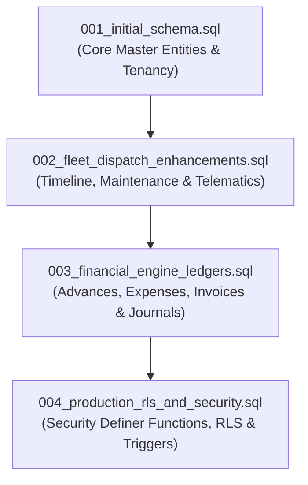

# STAGING MIGRATION & POSTGRESQL DEPLOYMENT CHECKLIST
**Transport Management System (TMS Pro)**  
**Version:** 1.0.0-rc1  
**Target Environment:** Isolated Supabase Staging Project  

---

## 1. Pre-Deployment Prerequisites

Before executing database migrations on staging, ensure:

- [ ] A dedicated Supabase staging project has been provisioned (do **not** reuse production or development projects).
- [ ] Staging database connection string and API keys are obtained:
  - `NEXT_PUBLIC_SUPABASE_URL`
  - `NEXT_PUBLIC_SUPABASE_ANON_KEY`
  - `SUPABASE_SERVICE_ROLE_KEY`
- [ ] Local Supabase CLI is installed and authenticated:
  ```bash
  npx supabase login
  npx supabase link --project-ref <staging-project-ref>
  ```
- [ ] Required PostgreSQL extensions are enabled in staging:
  ```sql
  CREATE EXTENSION IF NOT EXISTS "uuid-ossp";
  CREATE EXTENSION IF NOT EXISTS "pgcrypto";
  ```

---

## 2. Migration Execution Order & Verification

Migrations **must** be executed strictly in the following sequential order. Never execute out of order due to foreign key dependencies.



### Migration 1: `migrations/001_initial_schema.sql`
- **Scope:** Defines base tenancy and core transport entities.
- **Created Tables:**
  - `organizations`
  - `branches`
  - `users`
  - `vehicles`
  - `drivers`
  - `customers`
  - `lr_consignment_notes`
  - `trips`
  - `trip_consignments`
  - `proofs_of_delivery`
- **Verification Query:**
  ```sql
  SELECT count(*) FROM information_schema.tables 
  WHERE table_schema = 'public' 
  AND table_name IN ('organizations', 'branches', 'users', 'vehicles', 'drivers', 'customers', 'lr_consignment_notes', 'trips', 'trip_consignments', 'proofs_of_delivery');
  -- Expected: 10
  ```

### Migration 2: `migrations/002_fleet_dispatch_enhancements.sql`
- **Scope:** Operational timeline, telemetry, vehicle maintenance, and driver document compliance.
- **Created Tables & Indices:**
  - `trip_timeline_events`
  - `vehicle_maintenance_logs`
  - `driver_compliance_documents`
  - Composite indexes: `idx_trips_org_status`, `idx_lr_org_status`, `idx_vehicles_org_status`
- **Verification Query:**
  ```sql
  SELECT count(*) FROM information_schema.tables 
  WHERE table_schema = 'public' 
  AND table_name IN ('trip_timeline_events', 'vehicle_maintenance_logs', 'driver_compliance_documents');
  -- Expected: 3
  ```

### Migration 3: `migrations/003_financial_engine_ledgers.sql`
- **Scope:** Double-entry accounting ledger, GST invoicing, driver trip settlements, and Section 194C TDS.
- **Created Tables:**
  - `driver_advances`
  - `trip_expenses`
  - `driver_settlements`
  - `vendor_settlements`
  - `customer_invoices_v2`
  - `customer_invoice_items`
  - `journal_entries`
  - `journal_entry_lines`
- **Verification Query:**
  ```sql
  SELECT count(*) FROM information_schema.tables 
  WHERE table_schema = 'public' 
  AND table_name IN ('driver_advances', 'trip_expenses', 'driver_settlements', 'vendor_settlements', 'customer_invoices_v2', 'customer_invoice_items', 'journal_entries', 'journal_entry_lines');
  -- Expected: 8
  ```

### Migration 4: `migrations/004_production_rls_and_security.sql`
- **Scope:** Row-Level Security, multi-tenant security definer helpers, role-based policies, and ledger immutability triggers.
- **Key Objects:**
  - Helper functions: `auth_org_id()`, `auth_role()`, `auth_linked_driver_id()`, `auth_linked_vendor_id()`
  - Immutable trigger: `trg_prevent_journal_update` on `journal_entries` and `journal_entry_lines`
  - RLS enabled on all 20 tables.
- **Verification Query:**
  ```sql
  -- Verify all public tables have rowsecurity enabled
  SELECT tablename, rowsecurity 
  FROM pg_tables 
  WHERE schemaname = 'public' 
  ORDER BY tablename;
  -- Expected: All 20 tables show rowsecurity = true
  ```
- **Trigger Verification Query:**
  ```sql
  SELECT trigger_name, event_manipulation, event_object_table, action_statement 
  FROM information_schema.triggers 
  WHERE trigger_name = 'trg_prevent_journal_update';
  -- Expected: 2 rows (journal_entries, journal_entry_lines)
  ```

---

## 3. Storage Buckets & Policies Setup

Configure private storage buckets for tenant-isolated document storage:

1. Create Private Storage Buckets:
   - `tms-pod-documents` (Proof of delivery signatures and photos)
   - `tms-kyc-documents` (Driver licenses, Aadhaar copies, vehicle RC)
   - `tms-expense-receipts` (Fuel slips, toll receipts)
2. Storage Access Policies:
   - Ensure `public` access is disabled (`public = false`).
   - Tenant isolation policy:
     ```sql
     CREATE POLICY "Tenant Storage Isolation" 
     ON storage.objects FOR ALL 
     USING (bucket_id IN ('tms-pod-documents', 'tms-kyc-documents', 'tms-expense-receipts') 
            AND (storage.foldername(name))[1] = auth_org_id()::text);
     ```

---

## 4. Rollback Strategy & Plan

In the event of an unrecoverable migration failure on staging:

1. **Step-Down Rollback (Reverse Order):**
   ```bash
   -- 1. Disable triggers and drop RLS functions
   DROP TRIGGER IF EXISTS trg_prevent_journal_update ON journal_entries;
   DROP TRIGGER IF EXISTS trg_prevent_journal_update ON journal_entry_lines;
   DROP FUNCTION IF EXISTS prevent_journal_mutation CASCADE;
   DROP FUNCTION IF EXISTS auth_org_id CASCADE;
   
   -- 2. Drop financial tables
   DROP TABLE IF EXISTS journal_entry_lines CASCADE;
   DROP TABLE IF EXISTS journal_entries CASCADE;
   DROP TABLE IF EXISTS customer_invoice_items CASCADE;
   DROP TABLE IF EXISTS customer_invoices_v2 CASCADE;
   DROP TABLE IF EXISTS vendor_settlements CASCADE;
   DROP TABLE IF EXISTS driver_settlements CASCADE;
   DROP TABLE IF EXISTS trip_expenses CASCADE;
   DROP TABLE IF EXISTS driver_advances CASCADE;

   -- 3. Drop fleet dispatch extension tables
   DROP TABLE IF EXISTS driver_compliance_documents CASCADE;
   DROP TABLE IF EXISTS vehicle_maintenance_logs CASCADE;
   DROP TABLE IF EXISTS trip_timeline_events CASCADE;

   -- 4. Drop core master tables
   DROP TABLE IF EXISTS proofs_of_delivery CASCADE;
   DROP TABLE IF EXISTS trip_consignments CASCADE;
   DROP TABLE IF EXISTS trips CASCADE;
   DROP TABLE IF EXISTS lr_consignment_notes CASCADE;
   DROP TABLE IF EXISTS customers CASCADE;
   DROP TABLE IF EXISTS drivers CASCADE;
   DROP TABLE IF EXISTS vehicles CASCADE;
   DROP TABLE IF EXISTS users CASCADE;
   DROP TABLE IF EXISTS branches CASCADE;
   DROP TABLE IF EXISTS organizations CASCADE;
   ```
2. **Re-run validation** to ensure clean schema before re-applying fixed migrations.
