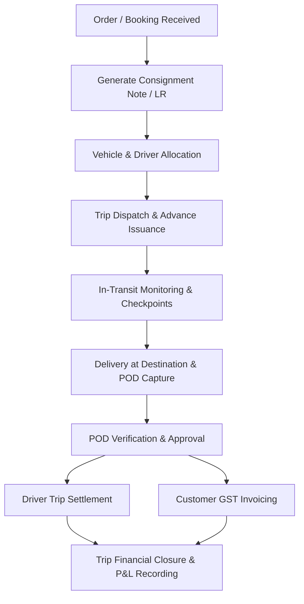
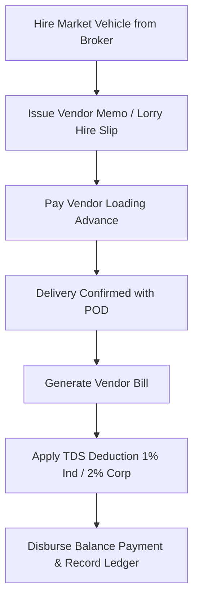
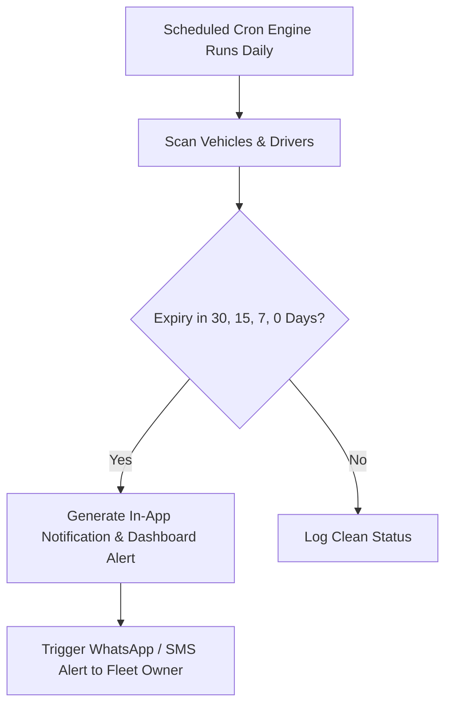

# WORKFLOW CATALOG: Core Logistics & Financial Lifecycles

## 1. Primary Operational Workflows

### WF-01: End-to-End Consignment & Trip Lifecycle

#### Steps & Business Rules:
1. **Booking & LR Creation:**
   - Input Consignor (Sender) and Consignee (Receiver) details, GSTIN, Pickup & Drop locations.
   - Enter Goods Description, Package Count, Weight (Actual vs Charged), Freight Rate type (`Per Ton`, `Per Bag`, `Fixed / Trip`).
   - Payment Terms: `To Pay` (Consignee pays on delivery), `Paid` (Consignor paid in advance), `T.B.B.` (To Be Billed / Credit account).
   - Validation: LR Number is auto-sequenced or uniquely enforced per branch. e-Way Bill number format (12 digits) verified.

2. **Vehicle & Driver Assignment:**
   - Select vehicle type: **Owned Fleet**, **Attached Fleet**, or **Market / Third-Party Vehicle**.
   - Check vehicle compliance: Alert if Insurance, Fitness, or National Permit has expired.
   - Assign Driver: Check driver licence validity and verify they have no unresolved critical trip block.

3. **Trip Dispatch & Advance Payment:**
   - Record initial Odometer reading and starting fuel level.
   - Issue Driver Trip Advance (Cash, Bank Transfer, or Fuel Card credit).
   - Update Trip Status -> `IN_TRANSIT`.

4. **In-Transit & Expense Tracking:**
   - Log en-route fuel purchases (Diesel quantity, rate, pump name / slip number).
   - Log FASTag toll charges and loading/unloading/weighbridge expenses.
   - In case of breakdown: Log breakdown, record repair expense, or initiate **Vehicle Transshipment / Reassignment** workflow.

5. **Delivery & Digital POD Capture:**
   - Driver or Unloading Agent marks trip `DELIVERED`.
   - Take photo / scan of physical signed & stamped LR copy (Proof of Delivery).
   - Enter Received Quantity, Damaged / Shortage quantity if any, and Receiver Remarks.
   - Status transitions -> `POD_SUBMITTED`.

6. **POD Verification & Customer Billing:**
   - Branch Manager or Accountant inspects POD image and approves -> `POD_APPROVED`.
   - Generate GST Invoice with 1-click: attaches approved LR#, applies freight, detention charges, loading labor, and CGST/SGST/IGST (5% RCM or 12% Forward Charge).

7. **Driver Settlement:**
   - Total Gross Advance (-) minus Approved In-Trip Expenses (+) minus Shortage Deductions (-) = Balance Payable / Recoverable.
   - Status -> `TRIP_CLOSED`.

---

### WF-02: Third-Party / Market Truck Vendor Settlement

### WF-03: Compliance Expiry & Renewal Reminders

